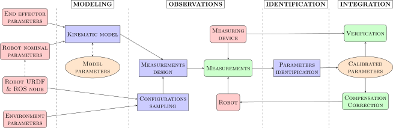
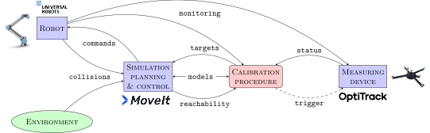

# robot_arm_calibration

A ROS-based kinematic calibration tool for serial robots: the unberdening of a crucial task

## Intro

This package provide multiple tools to perform an open-loop kinematic claibration of a serial robotic arm using an external position sensor.

It depends on the [robot_arm_tools](https://gitlab.ensta.fr/pascal.2020/robot_arm_tools) package, which offers a simplified interface for the use of robotic arms and the [MoveIt](https://moveit.ros.org) motion planning framework . It is compatible with most [serial robots included in MoveIt](https://moveit.ros.org/robots/) and sensors able to broadcast position data over ROS topics.

In its current version, the package was tested using ROS melodic, but shoul also work with ROS noetic as well.

## Feature overview

* A **complete integration** of all kinematic calibration steps into one single procedure : geometric modeling, state observations (_i.e._ measurements), parameters identification, verification and compensation or correction :
<!DOCTYPE html>
<html>
<body>
  <p style="background-color:white">
    
  </p>
</body>
</html>

* **Smooth hardware-software interfaces** based on the tried and tested MoveIt framework, and ROS standard communication tools _(Universal robots UR10e and Optitrack are given as examples)_
<!DOCTYPE html>
<html>
<body>
  <p style="background-color:white">
    
  </p>
</body>
</html>

* **Practical algorithmic adaptability** thanks to clear functionnal interfaces and a widespread programming language : Python.

More details are provided in the [Used technologies](#used-technologies) section.

## Contents

- [robot\_arm\_calibration](#robot_arm_calibration)
  - [Intro](#intro)
  - [Feature overview](#feature-overview)
  - [Contents](#contents)
  - [Getting Started](#getting-started)
    - [Requirements](#requirements)
    - [Install](#install)
  - [Usage](#usage)
    - [Preliminary configurations](#preliminary-configurations)
    - [Complete procedure](#complete-procedure)
    - [Separated steps](#separated-steps)
  - [Used technologies](#used-technologies)
    - [About the calibration procedure...](#about-the-calibration-procedure)
      - [Step 1: modeling (`scripts/robot_arm_calibration/AnalyticGeometricModel.py` `scripts/robot_arm_calibration/DHtoModel.py` `scripts/robot_arm_calibration/URDFtoModel.py`)](#step-1-modeling-scriptsrobot_arm_calibrationanalyticgeometricmodelpy-scriptsrobot_arm_calibrationdhtomodelpy-scriptsrobot_arm_calibrationurdftomodelpy)
      - [Step 2: observations/measurements (`src/robot_arm_calibration/robot_arm_calibration_sampling_node.cpp` `src/robot_arm_calibration/robot_arm_calibration_measurement_node.cpp` \& `scripts/robot_arm_calibration/TargetConfigurationsGeneration.py`)](#step-2-observationsmeasurements-srcrobot_arm_calibrationrobot_arm_calibration_sampling_nodecpp-srcrobot_arm_calibrationrobot_arm_calibration_measurement_nodecpp--scriptsrobot_arm_calibrationtargetconfigurationsgenerationpy)
      - [Step 3: identification (`scripts/robot_arm_calibration/ParametersIdentification.py`)](#step-3-identification-scriptsrobot_arm_calibrationparametersidentificationpy)
      - [Step 4: verification, compensation and correction (`scripts/robot_arm_calibration/ResultsDisplay.py` `scripts/robot_arm_calibration/ModeltoURDF.py` \& `robot_arm_tool` `RobotModel` class)](#step-4-verification-compensation-and-correction-scriptsrobot_arm_calibrationresultsdisplaypy-scriptsrobot_arm_calibrationmodeltourdfpy--robot_arm_tool-robotmodel-class)
  - [Testing](#testing)
  - [Contribute](#contribute)
  - [License](#license)

## Getting Started

### Requirements

* [ROS Melodic](http://wiki.ros.org/melodic/Installation/Ubuntu) 

### Install

First, use git to clone the required packages into your catkin workspace : 

```bash
mkdir -p catkin_ws/src && cd catkin_ws
git clone https://gitlab.ensta.fr/pascal.2020/robot_arm_tools
git clone https://gitlab.ensta.fr/pascal.2020/robot_arm_calibration
```

Install dependencies : 

```bash
sudo apt update
rosdep update
rosdep install --from_paths src --ignore-src -y
```

> :warning: The package depends on a modified version of the `urchin` python module, which can be installed as follows :
> 
> ```
> cd ~/catkin_ws/src
> git clone -b bugfix/lazy-save https://github.com/CarolinePascal/urchin.git
> cd urchin && python3 -m pip install .
> ```

And build packages :

```bash
catkin_make
source devel/setup.bash
```

> :warning: _Remark_ : before use, attention must be paid to the proper functioning of the _robot\_arm\_tool_ package, which involve the installation of the robot ROS driver !

## Usage

### Preliminary configurations

:warning: Before use, a few hardware related configuration files are to be created : 
   1. _(Only for DH parameters description)_ A Python file containing the modified Denavit Hartenberg parameters describing the robot. A template can be found at `/config/nominalModels/diverse/DH_template.py`;
   2. A YAML file containing a parameter named `robotBaseOffset` set to the robot base offset transformation regarding to the measuring device reference frame (no robot base measurements), or the measured robot base frame measurement;
   3. A Python file containing the geometric parameters of the tool used for position measurements. A template can be found at `config/nominalModels/marker/template.py`;
   4. A launch file for the used measuring device according to the template found at `launch/measuring_device_template.launch`;

### Complete procedure

Simply execute the corresponding script : 

```bash
rosrun robot_arm_calibration CompleteProcedure <robot_name> <robot_parameters_file> <robot_base_parameters_file> <marker_name> <marker_parameters_file>
```

### Separated steps

The calibration procedure can also be splitted into separated steps as follows : 
1.  Modeling step
    ```bash
    rosrun robot_arm_calibration InitParameters robot_name robot_parameters_file robot_base_parameters_file marker_name marker_parameters_file
    roscd robot_arm_calibration && cd config/calibratedModels/<robot_name>_<marker_name>
    python3 -m robot_arm_calibration.AnalyticGeometricModel.py
    ```
2. Sampling
    ```bash
    roslaunch robot_arm_calibration Sampling.launch robot_name:=<robot_name> tool_name:=<marker_name> sampling_parameters_file=<sampling_parameters_file>
    ```
   > _Remark_ : Examples of sampling parameters files can be found at `config/samplig`.
3. Measurements configurations choice
    ```bash
    roscd robot_arm_calibration && cd config/calibratedModels/<robot_name>_<marker_name>/<sampling_parameters>
    python3 -m robot_arm_calibration.TargetConfigurationsGeneration.py <target_configurations_choice_method> <choice_maximum_iteration_number> <target_configurations_number> <identifiability_score>
    ```
4. Measurements
    ```bash
    roslaunch robot_arm_calibration Measurements.launch robot_name:=<robot_name> tool_name:=<marker_name> target_configurations_file:=<target_configurations_file> measuring_device:=<measuring_device_name>
    ```
5. Identification
    ```bash
    roscd robot_arm_calibration && cd config/calibratedModels/<robot_name>_<marker_name>/<sampling_parameters>/<target_configurations_choice_method>
    python3 -m robot_arm_calibration.ParametersIdentification.py <identification_method> <stopping_criterion(relative_delta(local) or maximum_iterations(global))>
    ```
6. Verification
    ```bash
    roscd robot_arm_calibration && cd /config/calibratedModels/<robot_name>_<marker_name>
    python3 -m robot_arm_calibration.ResultsDisplay.py
    ```
1. Corrected URDF generation
    ```bash
    python3 -m robot_arm_calibration.ModeltoURDF.py <calibrated_model_file> <urdf_file>
    ```

## Used technologies

### About the calibration procedure...

#### Step 1: modeling (`scripts/robot_arm_calibration/AnalyticGeometricModel.py` `scripts/robot_arm_calibration/DHtoModel.py` `scripts/robot_arm_calibration/URDFtoModel.py`)

*   [x] Basic **geometric** modeling, using the method proposed by this [article](https://doi.org/10.1016/j.rcim.2015.03.007)
*   [x] Automatic model generation using either **modified Denavit-Hartenberg parameters** or an **URDF description** with [urchin](https://github.com/fishbotics/urchin)
*   [x] Generation of a formal expression for the robot model and identification Jacobian matrix using [sympy](https://github.com/sympy/sympy). This model provides the position of several end effector points given a robot joints angular configuration.
*   [ ] Handling **unconventional geometries** : prismatic joints, unaligned joints (i.e. not with a $\frac{\pi}{2}$ offset), parallel mechanisms, ...
*   [ ] Introduction of **more complex models**, including joints flexibilities
*   [ ] Integration of **full pose models** (_i.e._ all 6 degrees of freedom), and **lower degree partial pose models** (_e.g._ single distance measurements)

#### Step 2: observations/measurements (`src/robot_arm_calibration/robot_arm_calibration_sampling_node.cpp` `src/robot_arm_calibration/robot_arm_calibration_measurement_node.cpp` & `scripts/robot_arm_calibration/TargetConfigurationsGeneration.py`)
*   [x] Collision aware and spacially configurable **sampling of reachable robot configurations** using [MoveIt](https://github.com/ros-planning/moveit) simulation tool
*   [ ] Itegration of the measuring device perception range for robot configuration sampling
*   [ ] Integration of **cartesian space limits** for robot configurations sampling
*   [x] Combinatorial optimization based **choice of optimal measurement configurations** according to identifiability indexes. Based on [pygad](https://github.com/ahmedfgad/GeneticAlgorithmPython) and [simanneal](https://github.com/perrygeo/simanneal) for the corresponding methods
*   [ ] Implementing more optimal configurations selection methods !
*   [x] **Generic integration of position measuring device** based on remapped topic and parameters names
*   [ ] Handling of **full pose measurements** (_i.e._ all 6 degrees of freedom), and **lower degree partial pose measurements** (_e.g._ single distance measurements)
*   [ ] Handling of **camera based** measurements
*   [x] Automated and simultaneous position and joints values measurement process using [MoveIt](https://github.com/ros-planning/moveit) motion planning tool.
*   [x] Design and creation of rigid structures holding reference points markers, whose position is to be measured. One of this strucure is fixed to the robot flange (end effector points/markers - mandatory) and the other one is placed under the robot base (robot base points/markers - optionnal). CAD files are provided in `/doc/CAD`.
Full credits to [Thibault Toralba](thibault.toralba@ensta-paris.fr) and [Clément Yver](clement.yver@ensta-paris.fr)
*   [ ] Adding **custom layout** for robot base markers measurement

#### Step 3: identification (`scripts/robot_arm_calibration/ParametersIdentification.py`)
*   [x] Functionnal **parameters identification routine**, based on local and global minimization methods
*   [ ] Implementing more parameters identification methods !

#### Step 4: verification, compensation and correction (`scripts/robot_arm_calibration/ResultsDisplay.py` `scripts/robot_arm_calibration/ModeltoURDF.py` & `robot_arm_tool` `RobotModel` class)
*   [x] Automated **generation of an URDF description** based on the calibrated model parameters
*   [x] Integration of an error **compensation module** direcly to the `robot_arm_tool` package
*   [ ] Handling of **more complex models** !

## Testing

Ongoing discussion... Any tips or help will be greatly appreciated !


## Contribute

Pull requests are welcome. For major changes, please open an issue first to discuss what you would like to change !

## License
[GNU GPLv3](https://choosealicense.com/licenses/gpl-3.0/)


[comment]: <## Sources [Awesome article](http://The_reviwers_will_be_nice.com)>

